# My Farmhouse

[](https://github.com/him-agni/e-commerce-website/actions/workflows/ci.yml) [](https://github.com/him-agni/e-commerce-website/actions/workflows/e2e.yml)   

A full-stack modern-farmhouse furniture store, built as a portfolio project. Browse 60 products in 9 categories, pick a color, size and design, pay with Stripe (test mode), and ask an AI shopping assistant that searches the real catalog.

**Live demo: [my-farmhouse-pi.vercel.app](https://my-farmhouse-pi.vercel.app/)**

[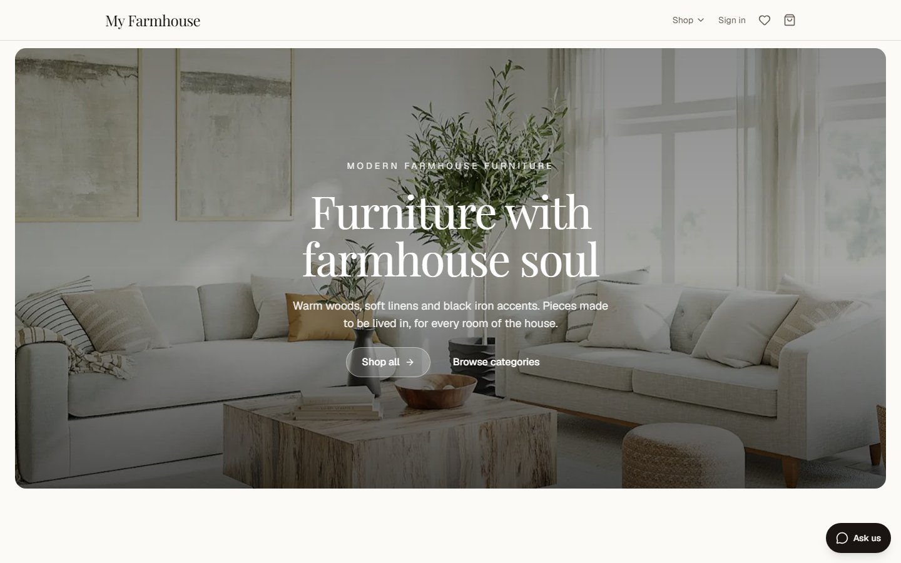](https://my-farmhouse-pi.vercel.app/)

[Try it](#try-it-in-two-minutes) · [Screenshots](#screenshots) · [How it works](#how-it-works) · [Design decisions](#design-decisions-worth-a-look) · [Getting started](#getting-started) · [Testing](#testing) · [Security](#security-and-privacy)

> **Nothing here takes real money.** Stripe runs in test mode only, and the app refuses a live Stripe key.

## Try it in two minutes

1. **Browse.** No account needed. Open the **Shop** menu, pick a hashtag such as `#accent-chair`, open a product, change its color, size or design, and add it to the cart.
2. **Check out.** Sign in or sign up (Clerk emails you a verification code), then press **Check out**. On Stripe's page use card `4242 4242 4242 4242`, any future date, any CVC and any US address. Nothing is charged or shipped. Afterwards the order appears under **My orders**.
3. **Ask the assistant.** Press **Ask us** (bottom right) and try *"I need a dining table for six, under $1,500"*. It runs on Google's free Gemini tier, so it can occasionally say it is busy; wait a minute and ask again.

## Screenshots

<table>
  <tr>
    <td width="50%">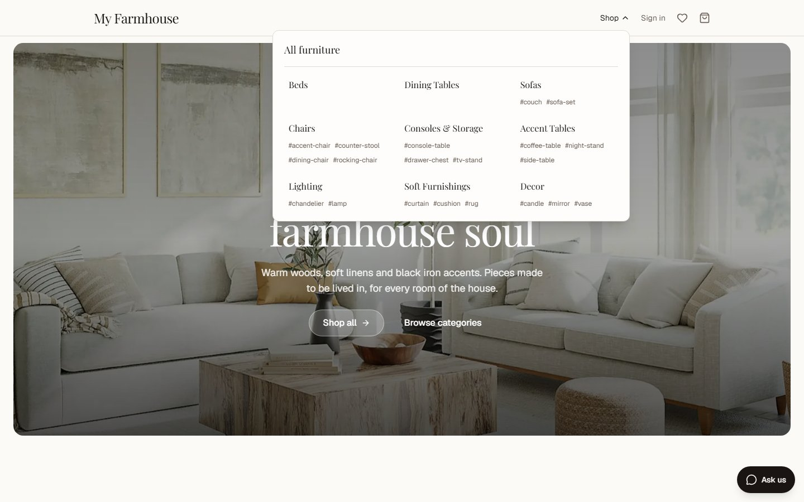<br><sub><b>Shop menu.</b> Nine categories; the old categories became hashtags that filter products inside each one.</sub></td>
    <td width="50%">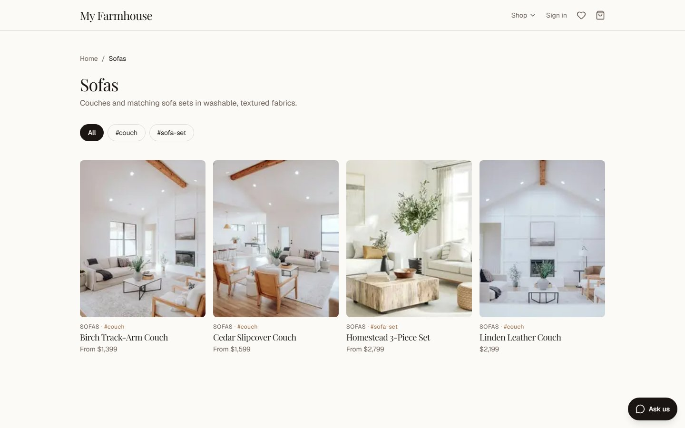<br><sub><b>Category page.</b> Each hashtag has its own filter pill and shareable address.</sub></td>
  </tr>
  <tr>
    <td width="50%">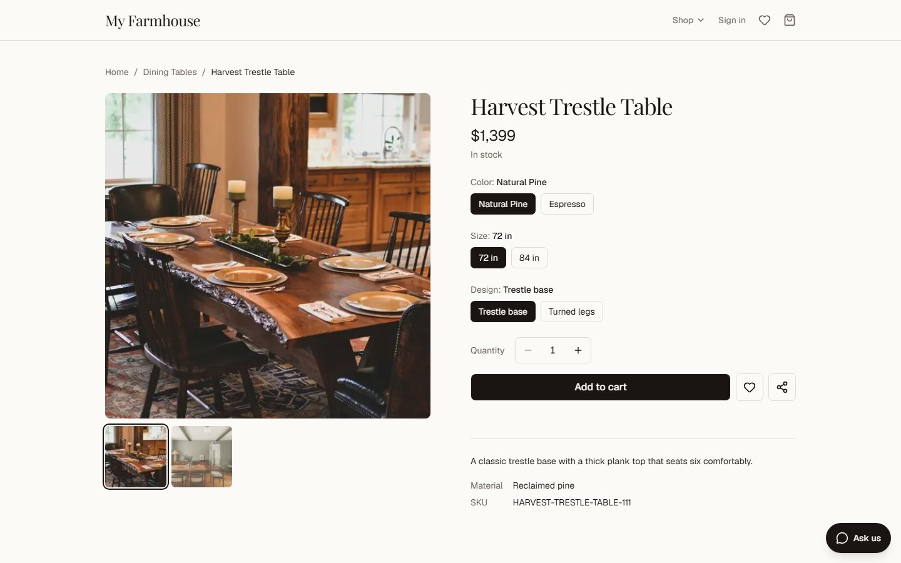<br><sub><b>Product page.</b> Options change the price, stock message and photo. Quantity is limited by stock.</sub></td>
    <td width="50%">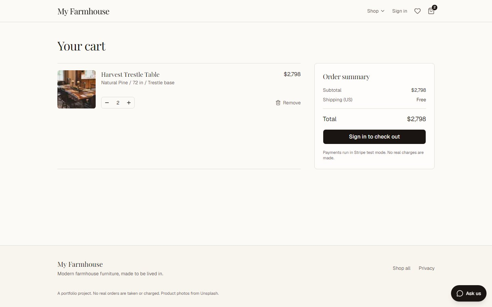<br><sub><b>Cart.</b> Kept in the browser; price and stock are re-checked against the catalog on every view.</sub></td>
  </tr>
</table>

<table>
  <tr>
    <td width="40%" align="center">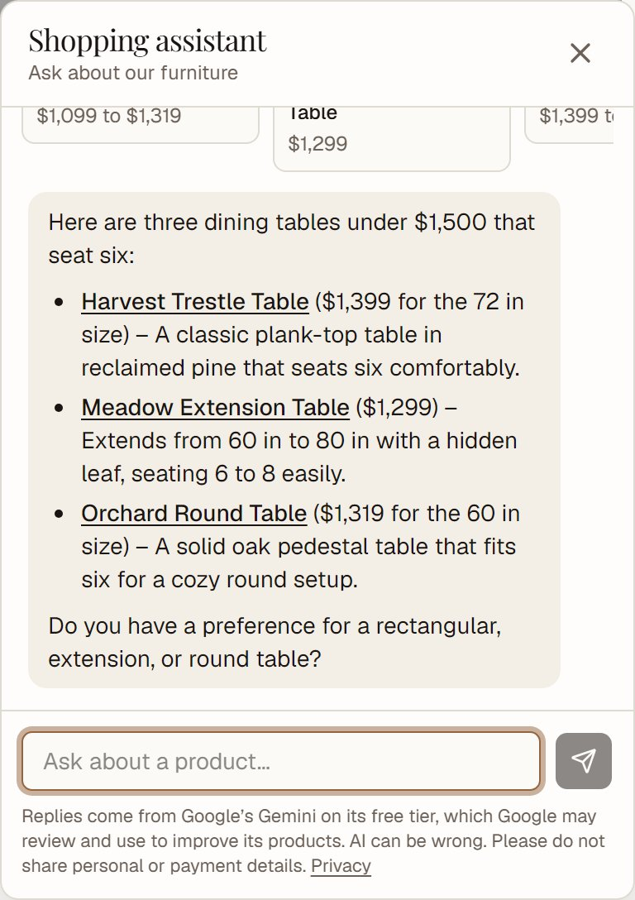<br><sub><b>Shopping assistant.</b> Searches the real catalog and links to products.</sub></td>
    <td width="30%" align="center">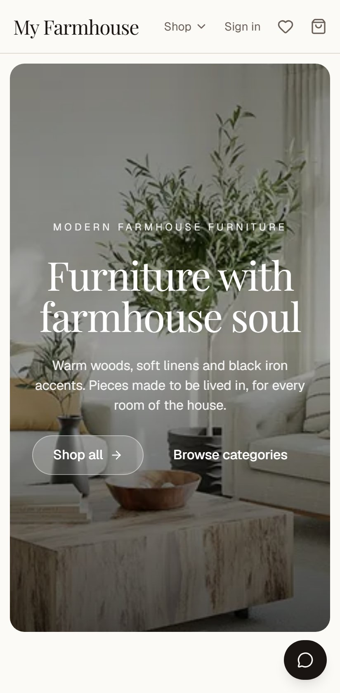<br><sub><b>Phone.</b> Home.</sub></td>
    <td width="30%" align="center">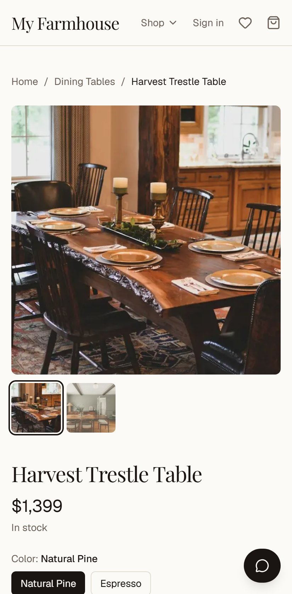<br><sub><b>Phone.</b> Product.</sub></td>
  </tr>
</table>

## Features

- **Storefront.** An animated home page, category pages, and product pages where choosing a color, size or design updates the price, stock message and photo. Motion is CSS-driven and respects "reduce motion".
- **Hashtags.** Inside a category, products are grouped by hashtags such as `#accent-chair` or `#tv-stand`. Each shows on the product and its card, has its own filter pill and shareable page (`/categories/chairs/accent-chair`), and appears in the Shop menu. The 17 original categories redirect permanently to their hashtag pages.
- **Product page extras.** A quantity stepper (limited by stock), a share button (the phone's share sheet, or copy-link on desktop), and a wishlist heart. The wishlist is saved in the visitor's browser only, on purpose: the Sanity dataset is public, so nothing personal goes there.
- **Accounts.** Sign up and sign in with Clerk. Checkout requires an account.
- **Cart and checkout.** The cart lives in the browser, with price and stock re-checked against the catalog on every view. Stripe Checkout sessions are built on the server from catalog prices, never from the browser.
- **Orders.** A Stripe webhook records each paid order, creates the customer and reduces stock in one safe-to-repeat step. Signed-in shoppers see their orders, with the shipping address, under **My orders**.
- **Shopping assistant.** A chat window powered by Google Gemini that searches the catalog, checks product options and stock, and (for signed-in shoppers) looks up their orders.
- **Admin.** The owner runs the store from Sanity Studio at `/studio`: edit products, prices, stock and photos, and update order status. Edits appear on the live site within seconds through a refresh webhook.
- **Quality.** Accessible (automated axe scans pass on seven pages), SEO-ready (sitemap, robots, structured data, canonical links), custom error and 404 pages, loading placeholders, and a [privacy page](https://my-farmhouse-pi.vercel.app/privacy).

## How it works

### The big picture

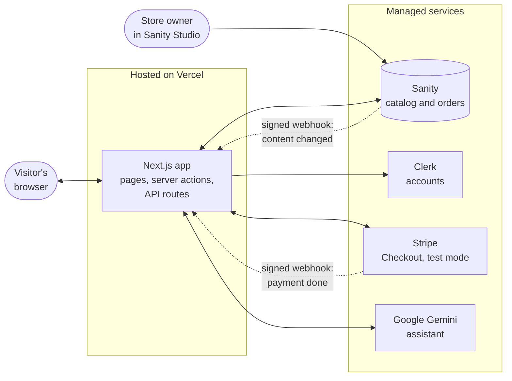

The shop's pages, cart and chat all go through the Next.js app. The app reads the catalog and writes orders in Sanity, checks who is signed in with Clerk, creates Checkout sessions and reads shipping addresses from Stripe, and relays assistant messages to Gemini. Sign-in and payment screens are served by Clerk and Stripe themselves, so passwords and card numbers never touch this app.

Dotted arrows are signed webhooks that call back into the app: Stripe when a payment completes (which records the order), and Sanity when the owner publishes a change (which refreshes the cached pages).

### From cart to order

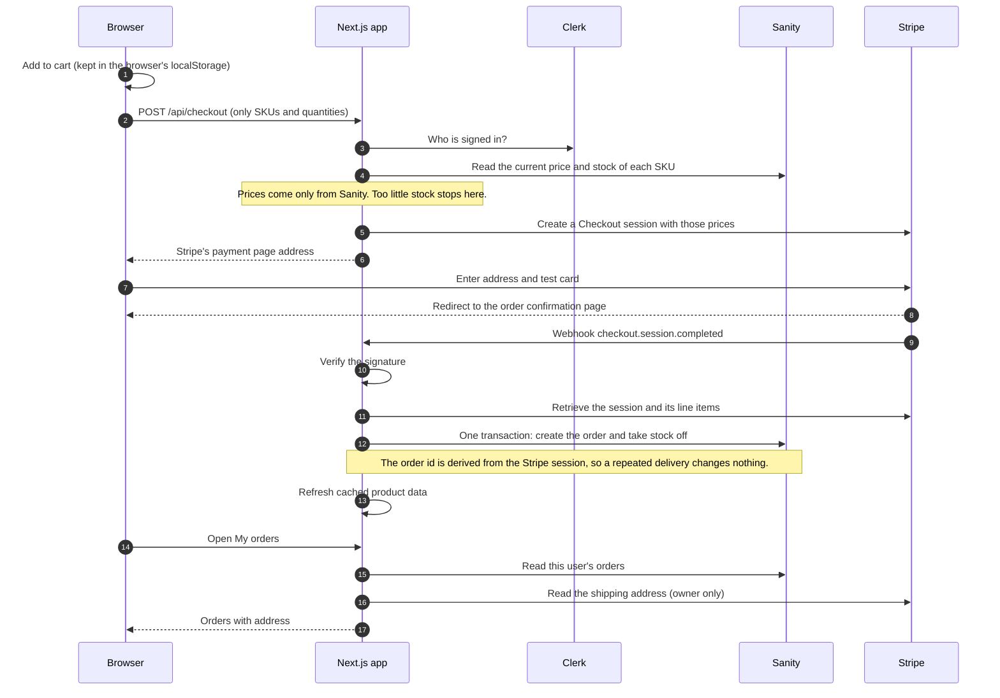

### The shopping assistant

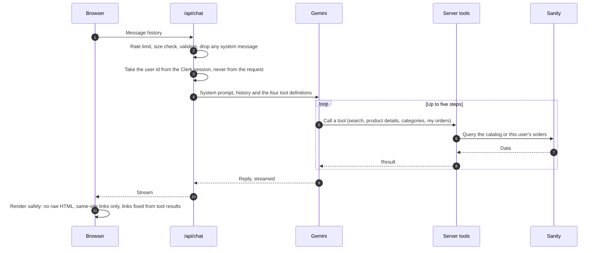

## Design decisions worth a look

| Decision | Why | Where |
| --- | --- | --- |
| **The server decides prices.** The browser sends only SKUs and quantities. | A shopper can't edit a price in the page and get it. Stock is re-checked at checkout too. | [`lib/checkout.ts`](lib/checkout.ts) |
| **Idempotent order recording.** The order id is derived from the Stripe session; creating it fails if it exists. | Stripe retries webhooks, and two can arrive at once. A repeat can never double-count an order or take stock off twice. | [`lib/orders.ts`](lib/orders.ts) |
| **No personal data in a public database.** Sanity's free plan is public-read, so orders hold no name, email or address, and not even the real user or Stripe ids. | Keyed hashes stand in for the ids, and the Stripe session id is stored encrypted so only the server can look up a shipping address. | [`lib/privacy-core.mjs`](lib/privacy-core.mjs), [docs](docs/deploy.md#data-privacy) |
| **Tagged caching plus a signed refresh webhook.** | Pages are fast and cheap to serve, yet an edit in Studio shows up in seconds. | [`lib/sanity/data.ts`](lib/sanity/data.ts), [`app/api/revalidate`](app/api/revalidate/route.ts) |
| **The assistant can't be talked into reading someone else's orders.** | The signed-in user comes from the server session; the order tool takes no input the model could change. | [`lib/ai/tools.ts`](lib/ai/tools.ts) |
| **A real Content-Security-Policy.** | It names only the origins the site uses, and a browser test fails if it ever blocks something needed. | [`lib/security-headers.ts`](lib/security-headers.ts) |
| **Tests aimed at the risky parts.** | Money, stock, webhooks and data leaks are where a bug costs the most; nine safeguards were broken on purpose to prove the tests catch it. | [Testing](#testing) |

## Tech stack

| Area | Choice |
| --- | --- |
| Framework | Next.js 16 (App Router, Cache Components), React 19, TypeScript |
| Styling | Tailwind CSS v4, shadcn/ui (Base UI), Playfair Display and Geist |
| Content and database | Sanity (Studio embedded at `/studio`); orders and customers live there too |
| Auth | Clerk |
| Payments | Stripe Checkout and webhooks (test mode) |
| AI | Vercel AI SDK v7 with Google Gemini |
| Testing | Vitest (unit and integration), Playwright (browser, accessibility), GitHub Actions |
| Hosting | Vercel Hobby |

## Getting started

You need Node.js 20.9 or newer (developed on 24) and accounts for Sanity, Clerk, Stripe, and Google AI Studio. All have free tiers (see [docs/deploy.md](docs/deploy.md#free-tier-limits)).

```bash
npm install
cp .env.example .env.local      # then fill in the values (see below)
npm run check-env               # confirms the keys look complete and untruncated
npm run seed                    # fills Sanity with the catalog and photos
npm run dev                     # http://localhost:3000
```

The Studio is at http://localhost:3000/studio. In the Sanity dashboard, add `http://localhost:3000` under **API → CORS origins** with credentials allowed.

### Environment variables

| Variable | Where to get it | Needed for |
| --- | --- | --- |
| `NEXT_PUBLIC_SANITY_PROJECT_ID`, `NEXT_PUBLIC_SANITY_DATASET` | sanity.io/manage → your project | everything |
| `SANITY_API_WRITE_TOKEN` | project → API → Tokens (Editor) | seeding, webhook writes |
| `NEXT_PUBLIC_CLERK_PUBLISHABLE_KEY`, `CLERK_SECRET_KEY` | Clerk dashboard → API keys | sign in |
| `STRIPE_SECRET_KEY` | Stripe dashboard → Developers → API keys (**test** key) | checkout |
| `STRIPE_WEBHOOK_SECRET` | printed by `stripe listen` (below) or your Stripe webhook endpoint | recording orders |
| `GOOGLE_GENERATIVE_AI_API_KEY` | aistudio.google.com/apikey | the assistant |
| `UNSPLASH_ACCESS_KEY` | unsplash.com/developers | the seed script only |
| `ORDER_ID_SECRET` | make one: `node -e "console.log(require('crypto').randomBytes(48).toString('base64url'))"` (32+ characters). **Never change it once orders exist.** | keeps real user and Stripe ids out of the public dataset |
| `SANITY_REVALIDATE_SECRET` | any random string (16+ characters) | live refresh after deploy |
| `NEXT_PUBLIC_SITE_URL` | your site's public URL | canonical links, sitemap, Stripe redirects |

Copy secret keys with the dashboard's copy button. Some dashboards show only a masked `sk_test_…`, and pasting that breaks authentication. `npm run check-env` catches this without printing any secret.

### Testing payments locally

Stripe must be able to reach your machine to confirm payments. Run this in a second terminal and keep it open while you test:

```powershell
$k = (Select-String -Path .env.local -Pattern '^STRIPE_SECRET_KEY=(.*)$').Matches.Groups[1].Value
stripe listen --api-key $k --forward-to localhost:3000/api/webhooks/stripe
```

It prints a `whsec_…` signing secret; put it in `.env.local` as `STRIPE_WEBHOOK_SECRET` and restart `npm run dev`. Pay with card `4242 4242 4242 4242`, any future expiry, any CVC, and any US address. (Passing `--api-key` avoids a stale saved `stripe login` pointing at another account.)

## Scripts

| Command | What it does |
| --- | --- |
| `npm run dev` | development server |
| `npm run build` / `npm start` | production build and server |
| `npm run lint` | ESLint |
| `npm run typecheck` | generates Next's route types, then runs the TypeScript compiler |
| `npm test` | unit and integration tests (Vitest); `npm run test:watch` re-runs on save, `npm run test:coverage` adds a coverage report |
| `npm run test:e2e` | browser tests (Playwright) against a running site; see Testing |
| `npm run screenshots` | retakes the README screenshots in `docs/screenshots/` (set `E2E_BASE_URL` to the site to shoot) |
| `npm run typegen` | regenerates TypeScript types from the Sanity schemas and GROQ queries (run after changing either) |
| `npm run seed` | creates categories, products and photos in Sanity; safe to re-run |
| `npm run check-env` | validates `.env.local` without printing secrets |

The seed script uses Unsplash's free API, which allows 50 requests an hour. Its data (`scripts/seed-data.mjs`) is organized as category, then hashtag groups, then products. If it stops with a rate-limit message, wait an hour and run it again; finished work is kept.

## Testing

There are two layers: **193 unit and integration tests** and **56 browser tests that run at desktop and phone size** (112 runs). Neither layer pays or writes to Sanity, so both are safe to run any time, including against the live site.

**Unit and integration tests (`tests/`, Vitest, about 5 seconds).** They cover the logic where a mistake would cost money or leak data, with Sanity, Stripe and Clerk replaced by fakes:

- *Checkout:* cart input is validated; the price charged always comes from Sanity, never the browser; stock is re-checked; every problem is reported at once.
- *Orders:* the order id comes from the Stripe session, so a repeated or simultaneous webhook cannot double-count; stock never goes below zero and oversold units are flagged; **no name, email, address, user id or session id ever reaches the public dataset**.
- *Webhooks:* Stripe's signature is verified with the real library (missing, wrong-secret and tampered bodies are all refused), and the Sanity refresh hook refuses unsigned calls.
- *Assistant:* the rate limiter, the tool results, the product search ranking, the chat route's validation (browser-supplied system messages are dropped; the user id comes from the session), and the reply renderer (no raw HTML, no external links).
- *Cart and wishlist:* stock and per-line caps, persistence, and the 50-item wishlist limit.
- *Catalog data and security headers:* nine categories, 60 products, unique slugs, valid hashtags, every old category address redirecting to a hashtag page that exists, and the Content-Security-Policy's shape.

**Browser tests (`e2e/`, Playwright, about two minutes for everything).** A real Chromium walks the storefront twice, once at desktop size and once as a Pixel 7 phone: the Shop menu, hashtag filters, old-address redirects, 404s, choosing a size, the quantity stepper, cart, wishlist, share, the assistant and its privacy notice, the sitemap and structured data, API routes refusing anonymous callers, no sideways scrolling, tap-sized buttons, security headers with no blocked resource, and an automated accessibility scan (axe, WCAG 2.1 A/AA) of seven pages.

**Signed-in flow.** One spec signs in as a dedicated Clerk test user, adds a product, presses Check out, and confirms Stripe opens in test mode with the right product, price and email. It stops there and never pays, so no order is created and no stock changes; the only trace is an unpaid Stripe test session. It skips itself unless these are set (in `.env.local`, or as CI secrets):

```bash
E2E_USER_EMAIL=e2e-tester@example.com       # a user created in your Clerk development instance
CLERK_SECRET_KEY=sk_test_...                # already in .env.local
NEXT_PUBLIC_CLERK_PUBLISHABLE_KEY=pk_test_...
```

Create the user in the Clerk dashboard (Users, Create user) with an ordinary address that nobody can receive mail at, such as `e2e-tester@example.com`. **Do not use a `+clerk_test` address:** Clerk development instances accept the fixed code `424242` for those, so anyone who knew the address could sign in as that user. The test signs in with a one-time token from Clerk's API, so it needs no password and no email code.

```bash
npm run dev                                              # in one terminal
npm run test:e2e                                         # in another (or let it start the server itself)
E2E_BASE_URL=https://my-farmhouse-pi.vercel.app npm run test:e2e   # against the live site
```

On GitHub, `.github/workflows/ci.yml` runs the dependency audit, lint, types and the unit tests on every push and pull request. `.github/workflows/e2e.yml` runs the browser tests against the live site on demand and once a day (add the three secrets named in that file to include the signed-in flow).

To check that the tests can actually fail, nine safeguards were broken on purpose (removing the stock check, the duplicate-order check, signature verification, the cart cap, and so on) to confirm the tests fail when they should. Automated accessibility checks find only some problems, so keyboard and screen-reader use still deserve a manual pass.

## Security and privacy

Built for a demo, so the aim is to protect what could be misused and be honest about what is left.

- **Money and orders.** Prices and stock are decided on the server; the browser only sends SKUs and quantities. Stripe webhooks are verified by signature and are safe to repeat, so an order cannot be double-counted. Stripe runs in test mode only, and the app refuses a live key.
- **Personal data.** Names, emails and shipping addresses never reach the public Sanity dataset. Neither do the real Clerk user id or Stripe session id: they are replaced by keyed hashes, and the session id is stored encrypted so only the server can look up a shipping address. Details and limits are in [docs/deploy.md](docs/deploy.md#data-privacy). The site has a [privacy page](https://my-farmhouse-pi.vercel.app/privacy), and the assistant says up front that replies come from Google's free-tier Gemini.
- **Browser hardening.** Every response sends `nosniff`, a strict referrer policy, a permissions policy and `X-Frame-Options`. Production pages also carry a Content-Security-Policy that names only the origins the site uses ([lib/security-headers.ts](lib/security-headers.ts)); an end-to-end test fails if it ever blocks something the site needs.
- **Abuse limits.** The assistant is rate limited, validates its input, and drops any system message sent from the browser. Replies are rendered without raw HTML and only same-site links are clickable.
- **Dependencies.** Updates are applied by hand (no bot commits to the repository), and CI fails on any critical advisory. Today `npm audit` still lists 16 issues in what ships, all of them inside Sanity's CLI and code-generation tooling (`braces`, `sprintf-js` and one `js-yaml` advisory have no published fix). None of that code handles visitor input, and the only fix offered is a breaking Sanity downgrade.

What the public Sanity dataset holds, and what stays private:

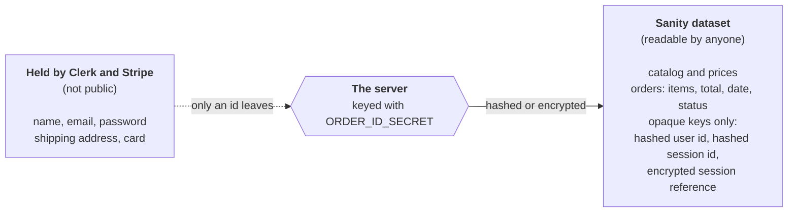

**Known limits.** Sign-in runs on Clerk's development instance (a custom domain is needed for a production one), which is weaker than production and shows a development badge. Purchase amounts, items and dates are still readable in the public dataset, just not linked to a person. The assistant's rate limiter lives in memory, so it resets when a server instance restarts. The Gemini free tier lets Google review conversations; the chat warns users.

## Project structure

```
app/(shop)/…        storefront pages (home, categories and hashtag pages, products), cart, wishlist, orders, privacy, sign in/up
app/api/…           checkout, Stripe webhook, Sanity refresh webhook, chat
app/studio/…        embedded Sanity Studio
components/…        UI (site, product, cart, assistant, shadcn/ui)
lib/…               catalog queries, cart, checkout, orders, privacy, security headers, assistant (tools, search, model)
sanity/…            schemas, client, generated types
tests/…             unit and integration tests (Vitest)
e2e/…               browser tests (Playwright)
scripts/…           seed, env check, screenshots, one-time migrations
docs/…              plan, deployment guide, screenshots, assistant examples
```

## Deploying

See [docs/deploy.md](docs/deploy.md) for the full checklist: Vercel, the Stripe and Sanity webhooks, Clerk, and the free-tier limits to keep in mind.

## Credits

Product photos come from [Unsplash](https://unsplash.com). Each uploaded photo keeps its photographer credit in the Sanity asset's credit line.
