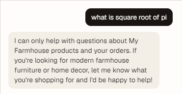
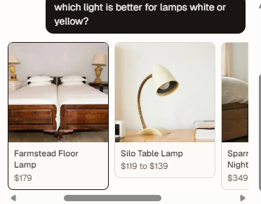
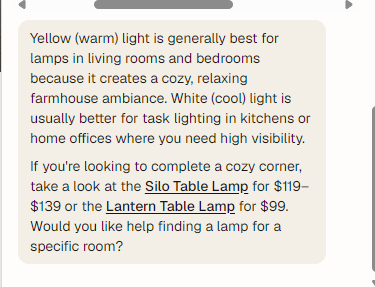

# Shopping assistant: example responses

Screenshots of real replies from the My Farmhouse shopping assistant (Gemini, with the store's catalog tools), taken on 2026-10-21. The wording of any reply will differ from run to run; these show typical behavior.

## 1. Off-topic question: politely declined

**Question:** "what is square root of pi"

**What it shows:** the assistant only discusses My Farmhouse products and the customer's orders. It declines unrelated questions (math, coding, general chat) without being rude, and invites the shopper to say what they are looking for. This comes from the rules in `lib/ai/system-prompt.ts`.

## 2. Product question: search results appear as cards

**Question:** "which light is better for lamps white or yellow?"

**What it shows:** when the assistant searches the catalog, the matching products are shown as photo cards (name and price, scrollable sideways) before its written answer. These come from the `searchProducts` tool and are rendered by `components/assistant/product-hits.tsx`.

**Worth knowing:** the first card (Farmstead Floor Lamp) shows a bedroom photo with table lamps in it. The Unsplash photo chosen for that product does not show the product itself. That is a catalog photo issue to fix in the Studio, not an assistant issue.

## 3. The written answer to the same question

**What it shows:**

- A short, helpful answer: warm (yellow) light for cozy living rooms and bedrooms, cool (white) light for task lighting in kitchens and home offices.
- Tying the advice back to the store: it recommends the Silo Table Lamp ($119 to $139) and the Lantern Table Lamp ($99), with working links to those product pages.
- Prices and product names come from the live catalog through the assistant's tools. It does not invent products.
- It ends with a follow-up question to keep the conversation going.
